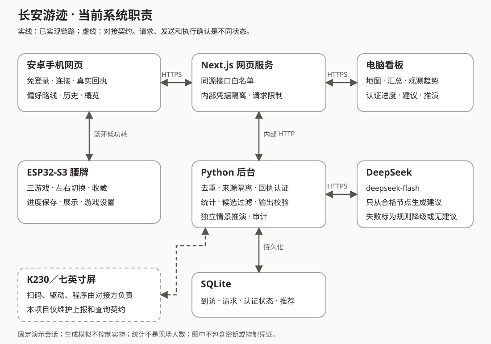

# 系统职责与接口索引

2026年10月3日，用于比赛讲解和开发对接。描述当前实现，不代替实物验收；范围以PRD最新补充及[固件和K230边界](../adr/0001-firmware-development-and-k230-boundary.md)为准。

## 系统职责图

实线为本项目实现的链路；虚线为K230对接契约，不表示扫码、驱动、屏幕程序已实现。箭头表示请求和响应，不表示设备已经执行。

| 组成 | 当前职责 | 事实边界 |
| --- | --- | --- |
| ESP32-S3腰牌 | 原生拖拽、本地通关、唯一收藏、展示、进度保存、游戏内设置、设备认证消息 | 手机发送不等于执行；后台不能代替实物触摸 |
| 安卓手机网页 | 免登录到访处理、身份核对、授权转发、回执上报、认证进度、概览和建议 | 不是安卓应用；测试打卡不能冒充摄像头扫码 |
| Next.js网页服务 | 同源接口白名单、请求限制、内部凭据隔离，提供手机页和电脑看板 | 免登录不授予终端上报权限，不取消设备认证 |
| Python后台与SQLite | 去重、请求状态、回执认证、统计、候选过滤、模型校验、审计和独立推演 | 生成模拟不控制实物；请求记录不能冒充设备执行 |
| DeepSeek | 使用 `deepseek-flash` 在合格节点中生成建议与短说明 | 不负责数人数、解锁或通关；失败明确降级或无建议 |
| 电脑看板 | 同一后台的地图、汇总、扫码间隔、观测趋势、认证进度、建议和推演 | 非真实地理地图；统计非现场人数；推演非现场效果 |
| K230／七英寸屏 | 对接方负责扫码、地点切换、队列、上报和界面；本项目维护契约 | 不宣称已实现或验收K230程序及识别率 |

手机到腰牌使用蓝牙低功耗（Bluetooth Low Energy, BLE）及 Web Bluetooth；电脑看板不直接连接腰牌。已解锁游戏和奖励本地运行，不要求手机一直在线。密钥、内部令牌不进入二维码或投屏材料。

## 地址与运行

- 手机：`https://babelbeast.com/xks`；电脑：`https://babelbeast.com/xks/dashboard`。
- 浏览器接口前缀：`/xks/api/v1`，无需登录或填写内部令牌。
- 正式后台8040、网页8041仅监听本机，外部浏览器通过域名反向代理访问；启停使用 `bash scripts/domain-demo.sh status|start|stop|restart`。尚未启用系统开机自动启动。
- 下表是后台相对路径；公开网页路径须加 `/xks`。后台业务接口仍要求相应内部令牌。
- K230的外部网络入口与终端凭据须与对接方确认，不能把本机 `127.0.0.1` 或公开网页代理当作终端接入地址。本索引不暴露新路径。

## 当前接口索引

| 方法与后台路径 | 用途 | 浏览器公开 |
| --- | --- | --- |
| `GET /api/v1/badges`、`POST /api/v1/badges` | 查询／不可覆盖的登记绑定，不产生到访 | 是 |
| `GET /api/v1/visits` | 到访及来源，处理状态结合请求记录 | 是 |
| `POST /api/v1/visits` | 终端实物扫码／模拟地点，终端令牌专用 | 否 |
| `GET /api/v1/terminal/configuration`、`PUT /api/v1/terminal/configuration` | 读取／切换地点，历史版本不改旧事件 | 否 |
| `POST /api/v1/terminal/heartbeat` | 终端反馈，不增加到访 | 否 |
| `POST /api/v1/interface-test/visits` | A点接口测试，核对实物后可联调，不计真实扫码 | 是 |
| `POST /api/v1/demo/visits` | 生成模拟事件，禁止控制实物 | 是 |
| `POST /api/v1/demo/prepare` | 每批10条虚拟记录，同批次重试不重复创建，不自动调用模型 | 是 |
| `GET /api/v1/unlock-commands`、`POST /api/v1/unlock-commands` | 查询／创建与合格到访、会话、腰牌绑定的请求 | 是 |
| `POST /api/v1/unlock-commands/{command_id}/sent` | 仅标已发送，不确认执行 | 是 |
| `POST /api/v1/badges/{badge_id}/state-challenges` | 认证状态查询，不解锁 | 是 |
| `POST /api/v1/badges/{badge_id}/unlock-commands/{command_id}/authorize` | 设备随机数和有期限授权 | 是 |
| `POST /api/v1/device-reports` | 提交原始回执，核验后更新进度 | 是 |
| `GET /api/v1/badges/{badge_id}/progress` | 最后认证状态，不证明当前在线 | 是 |
| `GET /api/v1/sites` | 位置、可达方向、任务可用性、阈值 | 是 |
| `GET /api/v1/map` | 窗口统计、观测趋势和节点转移，来源隔离 | 是 |
| `GET /api/v1/activity` | 同一时间的 `map`、`visits`、`trend_estimates`、`progress`；模拟进度不适用 | 是 |
| `POST /api/v1/recommendations` | 候选受限的模型／规则建议，不解锁 | 是 |
| `GET /api/v1/recommendations/{snapshot_id}` | 历史回读，不产生新模型请求或延长有效期 | 是 |
| `GET /api/v1/recommendations/{snapshot_id}/audit`、`GET /api/v1/recommendation-rejections` | 内部审计，不公开原始私有材料 | 否 |
| `POST /api/v1/simulation` | 独立情景推演，不写活动事实 | 是 |

终端令牌不能控制设备或登记腰牌。公开代理不接受浏览器令牌作为代理身份，不转发任意路径。

## 详细契约和操作顺序

[终端接口](../protocol/长安游迹终端接口.md) · [节点配置](../protocol/演示节点配置.md) · [手机流程](../protocol/手机腰牌操作流程.md) · [公开网页接口](../protocol/免登录演示网页接口.md) · [蓝牙接口](../protocol/长安游迹腰牌蓝牙接口.md) · [认证消息](../protocol/腰牌认证消息.md) · [活动快照](../protocol/看板活动快照接口.md) · [推荐接口](../protocol/下一站推荐接口.md) · [推演接口](../protocol/情景推演接口.md)。

登记 → 真实到访或明确标注的接口测试 → 手机核对身份并先同步 → 授权、发送、认证回执 → 腰牌本地通关收藏 → 后续同步 → 同来源看板。模拟推荐单独准备和讲解，不连接虚拟腰牌，不冒充真实扫码。

三分钟操作见[演示说明](三分钟演示说明.md)。此图及索引不证明外壳装配、真实操作录像或全部PRD已经交付。
